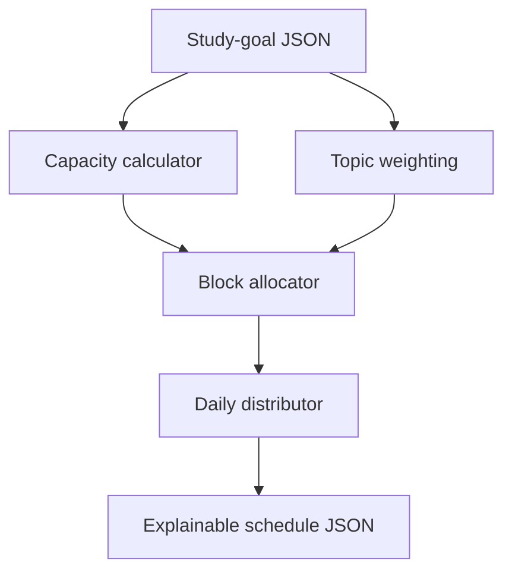

# Study Plan Builder

An explainable education agent that converts topics, deadlines, difficulty, confidence, and available time into a balanced daily study schedule.

## Problem

Learners often know what they must study but struggle to divide limited time across subjects. Equal time allocation ignores urgency, difficulty, and areas where confidence is low.

## How it works

1. Reads the learner's number of days, daily minutes, and preferred block length.
2. Calculates the total number of study blocks available.
3. Gives each topic a transparent weight based on difficulty, low confidence, and deadline urgency.
4. Allocates blocks proportionally while trying to give every topic at least one block.
5. Distributes allocated blocks across the available days.
6. Returns the schedule, topic weights, and capacity summary.

## Architecture



All processing is local and deterministic. No learner account, external AI service, or school system is required.

## Decision logic

The topic weight is:

```text
difficulty × (6 - confidence) × (1 + 7 / days_left)
```

Each scored field is constrained to a safe range. A difficult topic with low confidence and a close deadline therefore receives more blocks than a familiar topic with a distant deadline.

## Input and output

The input JSON contains `days`, `minutes_per_day`, `block_minutes`, and a `topics` array. Each topic supplies `name`, `difficulty`, `confidence`, and `days_left`.

The output contains a `schedule` array with numbered days and assigned topic blocks, plus a summary of total blocks and block length. Each block includes the calculated topic weight.

## Run and test

```bash
python app.py sample_data.json
python -m unittest -v
```

## Project structure

| File | Purpose |
| --- | --- |
| `app.py` | Weighting, allocation, scheduling, and CLI |
| `sample_data.json` | Example learner goal |
| `test_app.py` | Tests for urgency weighting and capacity |
| `agent.yaml` | OpenGAP manifest |
| `SOUL.md` | Agent purpose and boundaries |
| `EXPLAINABILITY.md` | Decision and limitation documentation |

## Safety and limitations

Difficulty and confidence are self-reported, and the schedule cannot know about unreported commitments, accessibility needs, illness, or changing course requirements. It is a planning aid and does not guarantee marks or replace a teacher.

## Passport submission

Publish this directory as a separate GitHub repository. Run `opengap validate` and test at least one supported adapter export before submission.
